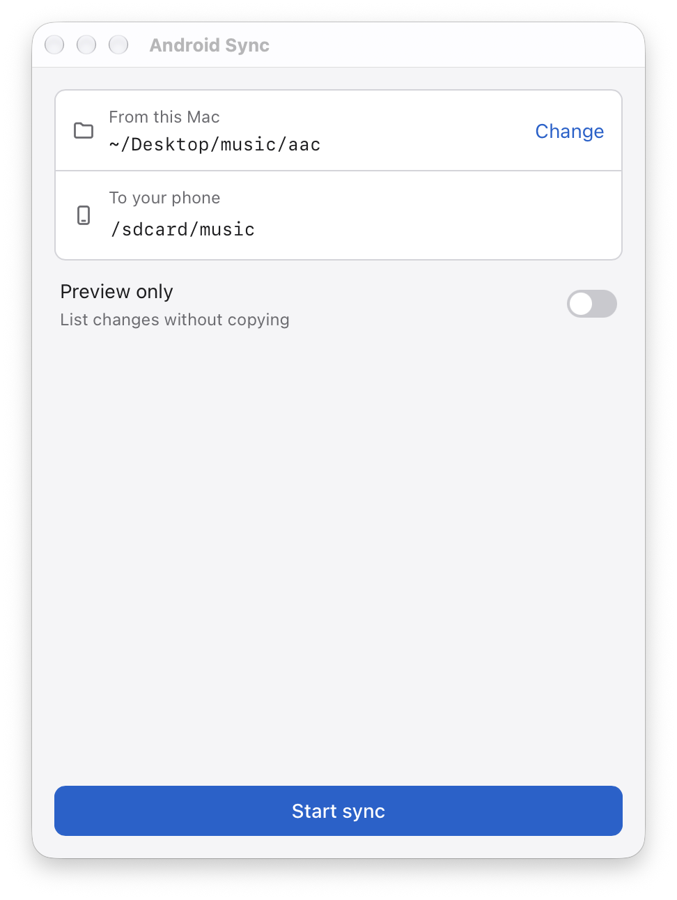

# Android Sync

A small Mac app that copies a folder from your Mac to an Android phone over USB.

<p align="center">
  
</p>

Pick a folder on your Mac, type the folder on the phone it should mirror it
to, and press **Start sync**. Android Sync talks to the phone directly over USB using
the ADB protocol, so you don't need Android File Transfer, MTP, or a separate
`adb` install.

## Download

Get the latest `.dmg` from the
[releases page](https://github.com/milesegan/android-sync/releases/latest),
open it, and drag **Android Sync** to Applications. It's signed and notarized,
and runs on Apple silicon and Intel Macs.

## What a sync does

- **Copies one way, Mac → phone.** A file is copied when it is missing on the
  phone, or its size or modification time differs from the Mac copy. Copied
  files keep the Mac file's modification time. Everything else is left alone,
  so running it again only copies what changed.
- **Deletes extra files on the phone** (on by default). After copying, files
  and folders inside the phone folder that aren't on the Mac are removed, so
  the phone folder matches the Mac folder. Turn off **Delete extra files** to
  only add and update files.
- **Creates folders** on the phone to match the folder structure on the Mac.
- **Skips dotfiles** such as `.DS_Store`, and anything that isn't a regular
  file or folder (symlinks, for example).
- **Preview only** runs the same check without copying or deleting, and
  reports how many files a real sync would copy and delete, and how many bytes
  it would transfer.
- **Cancel** stops a sync at any point, including while waiting for the phone
  to approve the connection. The file being copied when you cancel is removed
  by the phone, and the next sync copies it again.

> [!WARNING]
> With **Delete extra files** on, anything in the phone folder that isn't in
> the Mac folder is deleted, including files other apps saved there. Use a
> folder that only Android Sync writes to, and run **Preview only** first if
> you're unsure. A few things are always kept:
>
> - Hidden files and folders on the phone, such as `.nomedia` and
>   `.thumbnails`.
> - Anything matching a dotfile, symlink or other entry that was skipped on
>   the Mac.
> - Names are compared without case, so `Song.mp3` on the Mac keeps
>   `song.mp3` on the phone.
>
> Deleting is refused for the top of shared storage and similar folders
> (`/`, `/sdcard`, `/storage/emulated/0`, `/sdcard/Android` and other
> top-level folders), where it would remove other apps' files.

> [!NOTE]
> Version 1.0.0 and earlier didn't keep modification times, so files they copied
> are dated 1970 on the phone. The next sync copies those files again once,
> with the right dates.

## Using it

1. On the phone, turn on **Developer options** and then **USB debugging**
   (Settings → About phone → tap *Build number* seven times, then
   Settings → System → Developer options).
2. Connect the phone with a USB cable and unlock it.
3. In Android Sync, choose the folder on your Mac and enter the destination on
   the phone, for example `/sdcard/Music`. Both are remembered for next time.
4. Press **Start sync**. The first time, the phone asks *“Allow USB
   debugging?”*. Tap **Allow** (tick *Always allow from this computer* to skip
   the prompt in future).

The window follows your Mac's light or dark appearance.

### USB debugging key

The phone remembers which computers it trusts by their ADB key. Android Sync
uses your existing key at `~/.android/adbkey` (or under `$ANDROID_USER_HOME`)
if you have one, so a phone that already trusts your `adb` doesn't ask again.
Otherwise it creates its own key in the app's data folder and keeps reusing it.

## Troubleshooting

| Message | What to do |
| --- | --- |
| *No Android device detected over USB* | Check the cable, unlock the phone, and make sure USB debugging is on. Some cables only charge. |
| *Multiple Android devices detected* | Unplug all but one phone. |
| *Android is waiting for USB debugging approval* or *Android did not respond* | Unlock the phone and tap **Allow** on the prompt. If no prompt appears, reconnect the cable and try again. |
| *Deleting extra files isn't allowed in …* | The phone folder is the top of shared storage or another system folder. Choose a folder inside it, for example `/sdcard/Music`, or turn off **Delete extra files**. |
| *Another app is using the Android USB debugging connection* | Only one program can use the phone's debugging connection at a time. Quit Android Studio, scrcpy and similar tools, and stop any running ADB server with `adb kill-server`. |

## Building from source

You need:

- [Rust](https://rustup.rs) 1.88 or newer
- [Node.js](https://nodejs.org) and [pnpm](https://pnpm.io)
- The [Tauri prerequisites](https://tauri.app/start/prerequisites/) for your
  platform (on macOS, the Xcode Command Line Tools)

Then:

```bash
pnpm install
```

```bash
pnpm tauri dev
```

To build a release app bundle (written to `src-tauri/target/release/bundle/`):

```bash
pnpm tauri build
```

Run the Rust tests with:

```bash
cargo test --manifest-path src-tauri/Cargo.toml
```

The app is developed and tested on macOS.

### Releasing

Set the same `version` in `src-tauri/tauri.conf.json`, `src-tauri/Cargo.toml`
and `package.json`, commit, then tag the commit with that version and push the
tag, for example:

```bash
git tag v0.2.0
```

```bash
git push origin main v0.2.0
```

Only tags of the form `v1.2.3` start a release, and the workflow stops if the
tag doesn't match the version in all three files. The
[release workflow](.github/workflows/release.yaml) runs the tests, builds a
universal app, signs and notarizes it, and publishes a GitHub release for the
tag with the `.dmg` attached. It needs these repository secrets:
`APPLE_CERTIFICATE` (the Developer ID Application certificate as a base64
`.p12`), `APPLE_CERTIFICATE_PASSWORD`, `APPLE_SIGNING_IDENTITY`, `APPLE_ID`,
`APPLE_PASSWORD` (an app-specific password) and `APPLE_TEAM_ID`.

## How it's put together

Android Sync is a [Tauri 2](https://tauri.app) app with a React + TypeScript
front end.

| Path | What's there |
| --- | --- |
| `src/App.tsx`, `src/App.css` | The whole user interface |
| `src-tauri/src/lib.rs` | The sync: scanning the folder, connecting over USB, comparing against the phone, copying and deleting files |
| `src-tauri/src/adb_key.rs` | Finding or creating the USB debugging key |
| `src-tauri/vendor/adb_client` | A patched copy of the [`adb_client`](https://github.com/cocool97/adb_client) crate with faster USB writes and better recovery from interrupted transfers (see its `PATCH.md`) |

A sync scans the Mac folder, connects to the phone, creates any missing
folders, lists the files and folders already on the phone with `find`, pushes
each new or changed file along with its modification time, and then removes extra files with `rm` and empty
extra folders with `rmdir`. Progress is sent to the
window as `sync-progress` events.
